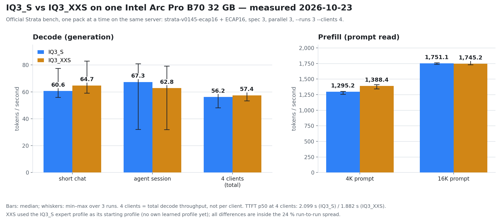

# ArcStrata — Qwen3.8-Flash-Next on an Intel Arc Pro B70 32 GB

*mw-dev-private, October 2026.* **ArcStrata** is a lean, Intel-Arc-only line built on
[Strata](https://github.com/Niko1221/Strata) (MIT): the idea and the engine are Strata's; this is the Intel-only
branch built on it. It serves **Qwen3.8-Flash-Next (GSQ-RCO IQ3_S)** on an **Intel Arc Pro B70** behind a coding
agent, a local assistant and an MCP client. Contributors are named at the bottom; the direction, the hypotheses
and the dead ends are mine.

> [!WARNING]
> **Work in progress.** ArcStrata is the Intel-Arc-only line, not a stable release. The Python serve/control layer
> is still upstream Strata's; the next step is to remove Python and replace it with the Rust server (`server-rs`,
> work in progress). Until that lands, this tree is the running snapshot, not an API promise.

**Next up: remove Python.**

**All the numbers on this page are mine, measured on this PC.** For Strata itself, its install and its own speed
tables see the [upstream README](https://github.com/Niko1221/Strata#readme) and, for the Intel port in general,
[docs/INTEL.md](docs/INTEL.md). The live state as of 2026-10-20 — binary, commit, flags, deployment chain, open
findings — is snapshotted in [docs/PROD-STATE-2026-10-20.md](docs/PROD-STATE-2026-10-20.md).

> **Name and lineage.** ArcStrata is this branch — not XeStrata and not JR-Strata, which are other, independent
> Intel forks. Upstream is [Niko1221/Strata](https://github.com/Niko1221/Strata) (MIT).

> [!IMPORTANT]
> **ArcStrata is Intel Arc only, and it is only the B70.** Everything here is the Intel engine: the SYCL sources under
> `sycl/`, built with `-DSTRATA_ENABLE_SYCL=ON`. **No CUDA, no ROCm, no Metal/Mac, no multi-GPU, no Windows**: those
> backends are not in this repository (removed in the 2026-10-23 lean cleanup), never compiled by my build command,
> never run and never measured here.
> Within Intel: every change was written, compiled, tuned and measured on one card, the **Arc Pro B70 32 GB**
> (Battlemage, PCI device `8086:e223`, `xe` kernel driver). The box has a second Arc, an **Arc Pro B60**
> (`8086:e211`), which I use as a test card for kernel experiments and for an embedding backend — it is not the
> target of this branch and none of the numbers below were measured on it. Nothing is validated on an A-series Arc,
> an iGPU or any other Intel card. If your card is not a B70, treat this branch as untested and use upstream.

> [!NOTE]
> **Every speed number here is measured the way I use the server every day**: 262,144-token context, thinking off,
> temperature 0, batch 3 slots with MTP, Strata's own bench tool (`python tools/strata_bench.py --runs 1`).
> Upstream's published tables use 4K answers on 32K prompts. Context and batching cost speed, and this machine's
> profile is not the profile of a 16 GB card.

## My PC

| | |
| --- | --- |
| **GPU (production)** | Intel Arc Pro B70, 32 GB, PCI `04:00.0`, device `8086:e223`, Battlemage, `xe` driver (`/dev/dri/renderD128`), Level Zero compute runtime 26.35.39758.10 |
| **GPU (test card)** | Intel Arc Pro B60, PCI `0b:00.0`, device `8086:e211` (`/dev/dri/renderD129`) — the card the kernel experiments ran on, and the card my embedding backend (`bge-m3`) sits on. **No number on this page comes from it** |
| **CPU / RAM** | Intel Core i7-14700F, 123 GiB DDR4-3200 on an MSI B760 Gaming Plus WiFi DDR4 board |
| **System** | Linux, kernel 7.0.0-34-generic |
| **Compiler** | Intel oneAPI DPC++/C++ 2026.1.1 — `icx` and `icpx` both set explicitly |
| **Build gate** | `-DSTRATA_ENABLE_SYCL=ON`: only `sycl/` is configured; the CUDA/HIP combination is a CMake error |
| **Device code** | SPIR-V, JIT-compiled for the B70 at first start with a persistent cache (`SYCL_CACHE_PERSISTENT=1`, fixed `SYCL_CACHE_DIR`), device picked by `ONEAPI_DEVICE_SELECTOR=level_zero:0`. `STRATA_SYCL_AOT` is deliberately **unset**; AOT measured ±0 |
| **Model** | Qwen3.8-Flash-Next GSQ-RCO **IQ3_S** (two GGUF shards, the second passed as `--ple-gguf`) |
| **Engine** | v0.1.45 fast base (`477ac13` line) + the ECAP fixes (in this `main`) — running binary `strata-v0145-ecap16` (sha256 `3110fd2c…`) |
| **Serve / control** | this branch: upstream v0.1.45 base (`477ac13`) + port + tokenizer optimizers + the Python fixes below; config in [prod-config/PT3M-262k.sample.json](prod-config/PT3M-262k.sample.json) |
| **Runtime settings** | `--max-context 262144`, `--kv int8`, `--batch 3 --spec 4` (MTP), `--pool-workers 12`, `--pcie-frac 0.20`, `--expert-cache auto`, `--conversation-cache-mib 16384 --conversation-cache-slots 8 --kv-resident 20480`, `--stream-experts`, vision on; armed gates: `STRATA_NATIVE_GRAPH=1`, `STRATA_BATCH_MTP=1`, `STRATA_TAIL_SKIP_IN_BATCH=1`, `STRATA_PREFILL_CPU_SHARE_BATCH=1`, `STRATA_SLOT_COPY_DIRECT=1`, int8 DPAS prompt experts **on by default** on Battlemage |

## How fast it runs here

Measured 2026-10-23 on the live server, one pack at a time (`strata-v0145-ecap16` + ECAP16, spec 3, parallel 3,
`tools/strata_bench.py --runs 3 --clients 4`):

*IQ3_S / IQ3_XXS, median (min–max over 3 runs): decode short chat **60.6 / 64.7**, agent session **67.3 / 62.8**,
4 clients total **56.2 / 57.4**; prefill **1,295.2 / 1,388.4** at 4K and **1,751.1 / 1,745.2** at 16K; TTFT p50 at
4 clients **2.099 s / 1.882 s**. All differences are inside the 24 % run-to-run spread, and the XXS run used the
IQ3_S expert profile as its starting profile (no own learned profile yet) — not a clean pack-to-pack win. The chart
is generated by [tools/plot_b70_iq3_compare.py](tools/plot_b70_iq3_compare.py).*

The older 131K-era tables and the A/B port charts lived on the archive branches `v0145-b70-sycl-fast` and
`docs-b70`; both were removed in the 2026-10-23 lean cleanup.

One honesty note that matters for reproductions: with `STRATA_TAIL_SKIP_IN_BATCH=1` a slot's answer **depends on
which other slots are busy** (the skip decision sees the whole window), and the serve path is not bit-stable
run-to-run on long greedy generations. Parity tests need an identical side load, not only an identical config.

## What changed since the first version of this README

- **The engine moved to upstream v0.2.0-beta** and carries: the int8 DPAS expert prefill (on by default on
  Battlemage, `STRATA_PREFILL_MMQ=0` turns it off), conversation-cache **slot KV copies** on device
  (`STRATA_SLOT_COPY_DIRECT=1`), **batch prefill CPU share** with an exclusive pool guard
  (`STRATA_PREFILL_CPU_SHARE_BATCH=1`), **tail routing skip inside batch windows**
  (`STRATA_TAIL_SKIP_IN_BATCH=1`), batch MTP, verify instrumentation (stamps, fetch counters) and the 262K context.
- **Tokenizer (Python side)**: two measured optimizers — byte mapping through a prebuilt `str.translate` table
  (mapping 52–68 % faster, ~1–2 % cold end to end) and merge rank keys deduped onto the vocabulary's own strings
  (**−28.7 MB RSS at load**, measured in fresh processes). A cache-refresh experiment exists as a knob but is **off
  by default**: bounded FIFO refresh helps cold-diverse workloads (100 → 1 BPE calls) yet hurts resending
  conversations 6× — details in `docs/PROD-STATE-2026-10-20.md`.
- **Context doubled to 262,144 tokens**, batch serve with 3 slots is the normal mode, pool workers 12 at PCIe frac
  0.20 is today's baseline.
- **2026-10-23 — the repository was cut down to the Intel-only line**: the running binary is
  `strata-v0145-ecap16` (v0.1.45 fast + ECAP); the old v0.2.0-beta/engine-int8 line and the archive branches were
  retired, and native CUDA, Metal, Windows/ROCm tooling and every benchmark result not measured on this PC were
  removed.

## What is in ArcStrata

- **[docs/PROD-STATE-2026-10-20.md](docs/PROD-STATE-2026-10-20.md)** — the live state as a dated snapshot: binary,
  source commits, config, deployment/rollback chain, measured numbers, open findings from the code review.
- **[prod-config/PT3M-262k.sample.json](prod-config/PT3M-262k.sample.json)** — the config the server actually runs
  (MCP bearer token redacted).
- **[PORT-0145.md](PORT-0145.md)** — the v0.1.45 production-port note from 17 October.
- **[docs/INTEL.md](docs/INTEL.md)** and **[docs/INTEL_ARC.md](docs/INTEL_ARC.md)** — the Intel port logs: what was
  tried, measured and dropped (FEK fusion, XMX prefill GEMM, AOT kernels, ESIMD, W4A16, the int8 MMQ chain and
  more — all with the measurements that ended them).
- [sycl/README_q6_planes.md](sycl/README_q6_planes.md), [sycl/README_prefill_refill.md](sycl/README_prefill_refill.md)
  — in-place Q6 head planes, asynchronous prefill loan refill.

Most engine changes are **opt-in by environment variable**; the int8 prompt experts are the one default-on change.
**Branches:** only `main` — the serve/control line the running server imports, plus the engine source and the ECAP
fixes. The old `engine-int8-v020-instr`, `v0145-b70-sycl-fast` and `docs-b70` branches and all tags were removed in
the 2026-10-23 lean cleanup. Nothing flows back upstream — this is my production box.

Speeds depend on the card, the RAM and the kind of text: these are one PC's numbers, not a promise. Nothing here was
tested for multi-GPU or vision throughput.

## Python fixes vs upstream Strata

The Python layer is still upstream's, but the running tree carries these fixes (the `A…` labels are the internal
audit IDs; the tests for each live in `serve/`):

- **Process ownership and lifecycle (A16/A17):** process, pump, log and generation are bound to one owner; an old
  `unload` can no longer unload its successor; a late `EngineStuck` keeps its own owner; a lazily/manually owned
  process is closed exactly once.
- **BT token stream (A03f):** a stream line is a token only if the native emitter can print it; a corrupt line ends
  the request as a 503 engine fault, never a 400 blaming the request and never a fabricated token.
- **PP / YIELDED / DONE parsing (A03g/A03h):** counters that cannot be printed are rejected instead of fabricating
  `Infinity`/`nan`/negative values; a corrupt `DONE` ends as an engine fault with the lifecycle intact; the consumed
  `DONE` reaches the caller before the figures.
- **Intel wrapper pump (A11c):** the A03e slot routing is restored in the wrapper's pump.
- **Request accounting (A12b):** with batch slots the control-lock wait is queue time and only the start itself is
  load time; a start at the request's own turn is recorded as load time, not left unattributed.
- **Telemetry (A12c):** no double-counted cache event under concurrent `/metrics` polls; a backwards disk counter or
  a raising reader is a missing sample, and the sampler thread survives.
- **Frontend:** the billing stamp is pinned only in the header's first 256 characters; colliding literal marks are
  relocated so original private-use text survives; `unmark_think_literals` uses a sparse `str.find` scan.
- **Reader / parsers (A12d):** numbers beyond float/int range in the Xe reader and gpustat are rejected instead of
  crashing the reader.
- **Embedding file (A04a):** a full `/dev/shm` or disk while writing the combined embeddings file is a 500, not a
  client that left.

## Origin and contributors

**Origin.** The idea and the engine are [Strata](https://github.com/Niko1221/Strata) by Niko1221, MIT. ArcStrata is an
independent, Intel-Arc-only line built on it.

**Contributors — these four, and nobody else:**

- **Me / a real human** ([mw-dev-private](https://github.com/mw-dev-private)) — direction, hypotheses, measurements, dead ends
- **DeepSeek** (deepseek-flash, DSH) — code, integration, measurements, documentation
- **OpenAI Codex** — code, reviews
- **Anthropic Claude** — code, reviews

## License

MIT, as upstream.
